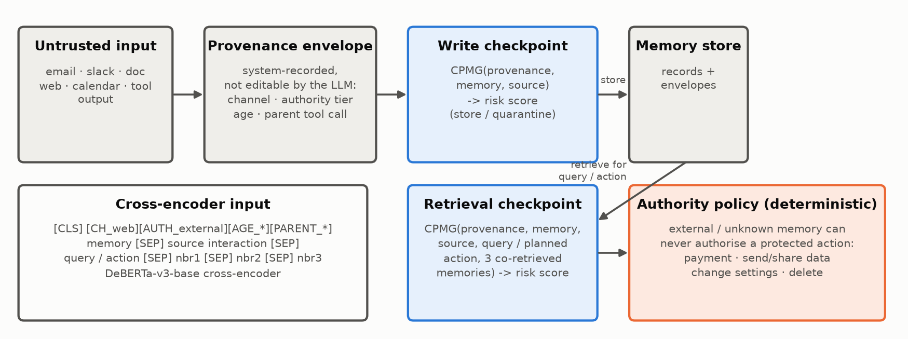
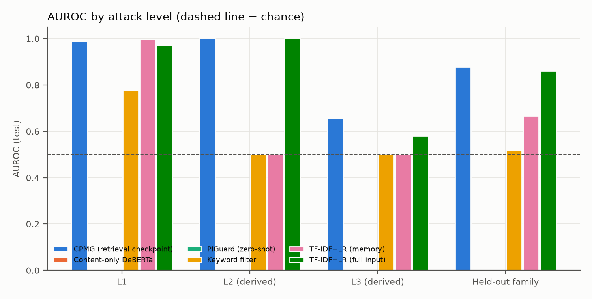

# CPMG: Contextual Provenance Memory Guard — Methodology and First Results

Agentic AI (AI-4015) · FAST-NUCES Islamabad · Instructor: Sohail Abbas 
Shahmeer Ali (23I-0119) · Mohammad Soban (23I-0056) · Ali Rauf (23I-0076) 
Deliverable: Proposed Methodology and Implementation · 8 November 2026

## 1 Problem and threat model

LLM agents save content from email, chat, documents, web pages and tool outputs into a persistent memory and
reuse it in later sessions. An attacker who controls any of that content can plant a record now that changes an
answer or a tool call later. We consider three attack levels. **L1 (direct):** one stored record carries the whole
malicious instruction. **L2 (compositional):** the harmful content is spread over two or more records, and it only
takes effect when they are retrieved together. **L3 (dormant):** the record does nothing until a later query (or
entity, date or action) supplies its trigger. The attacker controls record *content* and can choose wording; they
cannot edit system-recorded metadata (which channel a record came through, its authority tier, its parent tool
call). A pointwise filter such as PIGuard scores one string at a time, so by construction it cannot see the
neighbour that completes an L2 attack or the query that wakes an L3 record. A defence also has to keep useful
memory, so we report false rejections of matched benign records alongside detection.

## 2 Method

**Provenance envelope.** Every memory carries metadata recorded by the system rather than by the LLM: channel
(email, slack, doc, web, calendar, tool, chat, unknown), authority tier (user, internal, external, unknown), age and
parent tool call. Each value is a new special token added to the tokenizer.

**Model.** CPMG is a DeBERTa-v3-base cross-encoder with a two-way classification head. Its input is
`[CLS] provenance-tokens memory [SEP] source-interaction [SEP] query/action [SEP] nbr1 [SEP] nbr2 [SEP] nbr3 [SEP]`
(maximum 512 tokens; budgets of 32/48/64 tokens for source, query and each neighbour; the memory gets the rest).
The risk score is P(poisoned).

**Two checkpoints.** At *write* time there is no future query yet, so the write model sees provenance, memory and
source only. At *retrieval* time CPMG re-scores the record with the current query or planned action and the
co-retrieved memories. "Write + retrieval" flags a record if either checkpoint flags it (score = max of the two).

**Training.** Weighted cross-entropy (class weights inverse to frequency), AdamW, learning rate [[run:cpmg_full:config:lr]], linear schedule
with warm-up, [[run:cpmg_full:config:epochs]] epochs, batch [[run:cpmg_full:config:batch_size]] with gradient accumulation [[run:cpmg_full:config:grad_accum]], bf16 autocast over fp32 weights, gradient
checkpointing, seed 42. The checkpoint with the best validation AUROC is kept. The supervised contrastive term was
not added (time).

**Authority policy.** A small deterministic module, separate from the model: memory whose authority is `external`
or `unknown` can never authorise a protected action (payment, send/share data, change settings, delete). It does
not use the risk score.

## 3 Data and splits

**Real public data only.** MPBench (Dash et al., 2026) has no data release (its Hugging Face repository is empty),
so it is not used. We use five public sources: **AgentPoison** (NeurIPS 2024; StrategyQA and EHRAgent memories),
**ASB** (ICLR 2025; memory-poisoning plans from its direct-prompt-injection runs), **MemoryGraft** (benign and poisoned
experience records), **memshield-bench** (whose poisoned entries were written by the dataset's author) and
**NotInject** ([[stats:test_notinject:n]] benign prompts containing trigger words, used only to test over-defence). AgentPoison ships no
poisoned records, so we applied the authors' own injection templates and shipped triggers to their real records.
Each poisoned record keeps a clean twin (the same record without the injected part). ASB ships poisoned memory only,
so we ran ASB's clean planning path with a local Qwen3-8B model to get clean plans for the same agents and tasks.
Provenance comes from each source's documented origin (Table 1 in `results/DECISIONS.md`, D4), because no source
records per-item metadata.

**Derived L2 and L3.** L1 cases are real records as stored. L2 and L3 are **derived** from AgentPoison records, where
the injected span and trigger are known exactly. *L2:* the scored memory is the record without its injected span
(identical to its clean twin), and the injected span is stored as a separate co-retrieved record; the negative is the
same memory with clean neighbours only. *L3:* the scored memory is the full poisoned record, whose backdoor waits for
a trigger; the positive has the trigger in the later query, and the negative is the same question without it. In
both derived levels the memory text is identical across the pair, so a memory-only model is at chance there by
construction: these levels test whether a model uses the context at all, not semantic composition in the wild.

**Splits.** Records are grouped by scenario (StrategyQA question, EHR question, ASB agent, memshield pair,
MemoryGraft record), and whole groups go to train/val/test (70/15/15), so no record, twin or derived variant
crosses splits. The **BadChain trigger family is held out**: its groups never appear in train or val. ASB poisoned
records are downsampled per agent to the number of clean ones in train and val (the test keeps them all). As a
**cross-source test**, a second CPMG model is trained without ASB and tested on all ASB records. Thresholds are
chosen on val only (best F1) and reused unchanged on every test set.

Table 1. Dataset (seed 42). Background clean = StrategyQA knowledge-base paragraphs.

[[table:data]]

## 4 Baselines

**Content-only DeBERTa:** the same model and training, memory text only (the pointwise baseline).
**PIGuard:** the public checkpoint `leolee99/PIGuard`, zero-shot on the memory text; we rebuilt its model class (a
DeBERTa-v2 encoder with a linear head) locally and loaded the published weights. **Keyword filter:** a fixed list of [[run:keyword:n_patterns]] generic injection patterns, no
training. **TF-IDF + logistic regression:** on the memory text, and on the same flattened input CPMG sees. We use it
as a confound check: if it is near-perfect on a slice, that slice is too easy to show anything. **Provenance-only
logistic regression:** one-hot channel, authority and parent only, to check that provenance does not leak the label.
**Ablations:** CPMG without provenance, without query/action, without neighbours, write-only, and write + retrieval.

## 5 Results

All numbers below are produced by `eval.py` from our prediction files (single seed 42). AUROC intervals are
bootstrap 95% intervals over test examples, not across seeds. F1 and false-rejection rates (FRR) use the threshold
chosen on val.

Table 2. Test set, all levels. FRR twins = benign twins flagged; FRR NotInject = benign prompts flagged.

[[table:main]]

**Overall.** At its retrieval checkpoint, CPMG reaches AUROC [[cpmg_full:test_all:auroc]]
[[cpmg_full:test_all:auroc_ci95]], against [[content_only:test_all:auroc]] for the same model trained on the memory
text alone, [[piguard:test_all:auroc]] for PIGuard and [[tfidf_full:test_all:auroc]] for TF-IDF on the full input.
At 1% FPR it detects [[cpmg_full:test_all:tpr_at_1fpr:%]]% of poisoned cases, against
[[content_only:test_all:tpr_at_1fpr:%]]% for content-only. Combining the write and retrieval checkpoints gives a
similar AUROC ([[cpmg_write_retrieval:test_all:auroc]]) and a lower FRR on benign twins
([[cpmg_write_retrieval:test_all:frr_twins:%]]% vs [[cpmg_full:test_all:frr_twins:%]]%). The gain comes entirely from
the derived levels, as the per-level results show.

Table 3. Per level. Each level compares its positives with its own negatives (matched twins; L1 also
includes the clean ASB, memshield and MemoryGraft records).

[[table:levels]]

**L1 is too easy to separate methods.** TF-IDF on the memory text alone reaches [[tfidf_memory:L1:auroc]] and
content-only DeBERTa [[content_only:L1:auroc]] on L1; CPMG gets [[cpmg_full:L1:auroc]]. Following our
confound check, we do not use L1 to argue for CPMG: the injected text is lexically distinct from clean records in
every source.

**L2 (derived).** The memory text is identical across each L2 pair, so every memory-only model sits at chance
([[content_only:L2:auroc]] for content-only). CPMG reaches [[cpmg_full:L2:auroc]], but TF-IDF on the full input
also reaches [[tfidf_full:L2:auroc]]. Once the payload fragment sits among the neighbours it is lexically obvious, so
this level shows that **reading co-retrieved records is necessary**, not that CPMG composes meaning across records.

**L3 (derived) is the hard case.** CPMG reaches AUROC [[cpmg_full:L3:auroc]] (TPR [[cpmg_full:L3:tpr_at_5fpr:%]]% at
5% FPR), the best of all models, but it flags [[cpmg_full:L3:frr_twins:%]]% of the dormant-but-untriggered twins at
the val threshold. Split by trigger family, CPMG separates the trigger seen in training perfectly
([[cpmg_full:seen_L3:auroc]]) and the held-out BadChain trigger not at all ([[cpmg_full:heldout_L3:auroc]]). The
model has learned the specific trigger string, not the relation "the query contains the trigger this memory waits
for".

Table 4. Ablations, test AUROC (last column TPR at 5% FPR over all levels).

[[table:ablation]]

**Ablations.** Removing the neighbours drops L2 to [[abl_no_nbrs:L2:auroc]]; removing the query drops L3 to
[[abl_no_query:L3:auroc]]. Each context segment carries the level it was built for. Removing provenance barely changes
AUROC ([[abl_no_prov:test_all:auroc]] vs [[cpmg_full:test_all:auroc]] overall), though L1 TPR at 5% FPR falls from
[[cpmg_full:L1:tpr_at_5fpr:%]]% to [[abl_no_prov:L1:tpr_at_5fpr:%]]%. The write-time model
([[write_only:test_all:auroc]]) behaves like content-only ([[content_only:test_all:auroc]]): at write time there is
no query and no neighbour, so L2 and L3 cannot be seen. **Provenance leak check:** a classifier on provenance alone
reaches [[prov_only:test_all:auroc]] overall ([[prov_only:L1:auroc]] on L1). Our provenance is assigned per source,
so it mostly identifies the source. It leaks a little, and this data cannot show a provenance benefit.

Table 5. Generalisation to the held-out attack family (AUROC).

[[table:generalisation]]

**Held-out family.** On the BadChain groups, CPMG reaches [[cpmg_full:heldout_family:auroc]] against
[[content_only:heldout_family:auroc]] for content-only. The whole gain comes from L2, where the payload is visible in
the neighbours whatever the trigger ([[cpmg_full:heldout_L2:auroc]]); on held-out L3 it is at chance.

Table 6. Cross-source test: models never trained on ASB, tested on all ASB records.

[[table:xsource]]

**Cross-source (ASB).** Trained without ASB, CPMG transfers poorly: AUROC [[cpmg_noasb:asb_xsource:auroc]], and at
its own val threshold it flags [[cpmg_noasb:asb_xsource:recall:%]]% of ASB attacks. PIGuard
([[piguard:asb_xsource:auroc]]) and the keyword filter ([[keyword:asb_xsource:auroc]]) do much better, because ASB's
injections use classic prompt-injection phrasing ("Ignore previous instructions", "You must strictly adhere ...").
Our keyword list was written after we had inspected the sources and contains two such phrasings, so its ASB number
is optimistic. Within-source, all trained models separate the two held-out ASB agents perfectly (per-source table in
`results/tables.md`).

**Over-defence.** On NotInject, CPMG flags [[cpmg_full:notinject:fpr_all_neg:%]]% of benign prompts, content-only
[[content_only:notinject:fpr_all_neg:%]]%, PIGuard [[piguard:notinject:fpr_all_neg:%]]% and TF-IDF (memory)
[[tfidf_memory:notinject:fpr_all_neg:%]]%. NotInject is out of distribution for the context models (unseen
provenance values, no query or neighbours), so we treat these rates as indicative only.

Table 7. Cost per check (batch size 1; GPU = RTX 5060 Laptop, bf16).

[[table:cost]]

**Cost.** One CPMG check is a single encoder pass ([[run:cpmg_full:latency_ms_bs1:.1f]] ms,
[[run:cpmg_full:n_params:,]] parameters), comparable to PIGuard ([[run:piguard:latency_ms_bs1:.1f]] ms) and with no
LLM calls. Running both checkpoints doubles it. The comparison with A-MemGuard's LLM calls is deferred to the paper.

Table 8. Authority policy on real (non-derived) records. The proposed action is read from the
memory text with fixed keyword rules (a proxy for a live tool call).

[[table:policy]]

**Authority policy.** In the test set, [[policy:test:label=1|protected_action]] poisoned records propose a protected
action and the policy blocks [[policy:test:label=1|blocked]] of them: all those from external or unknown sources.
It blocks none of the [[policy:asb_xsource:label=1|protected_action]] protected ASB actions, because ASB's injection
enters through the user prompt (authority `user`), and none from EHR (authority `internal`). By design it also blocks
the [[policy:test:label=0|blocked]] clean external/unknown records that propose a protected action. That is the
utility price of the rule.

## 6 Limitations and next steps

- **Data.** There is no MPBench release. L2 and L3 are *derived* from AgentPoison records with a fixed payload and two
  triggers, so they test whether context is used at all, not attacks in the wild. L1 is easy enough that TF-IDF
  nearly solves it. memshield's poisoned entries were written by one author. ASB's poisoned plans come from
  gpt-4o-mini and its clean plans from our Qwen3-8B run (a style confound).
- **Provenance** is assigned per source from documentation, because no public dataset records it per item. It is
  therefore close to a source identifier, it leaks some label signal, and its benefit cannot be measured here.
- **Generalisation.** CPMG memorises the trained trigger (held-out L3 at chance) and does not transfer to ASB.
  Training with many triggers, the supervised contrastive term against benign twins, and paraphrased triggers are
  the next steps.
- **Evaluation.** Single seed; intervals are bootstrap over examples only. The policy is evaluated with an
  action-keyword proxy, not a live agent. NotInject is out of distribution for the context models.
- **Deferred to the paper (18 Nov).** A-MemGuard on a subset (local llama.cpp model), adapted BlindGuard, end-to-end
  attack success in a sandboxed agent, LongMemEval utility, 3 seeds, a paraphrase adaptive attack.

Code, data-production scripts, decision log (`results/DECISIONS.md`) and every metric file are in the
project repository. All numbers in this report are filled in automatically from `results/` by
`report/build_report.py`.

## References

- Chen, Xiang, Xiao, Song, Li. AgentPoison: Red-teaming LLM agents via poisoning memory or knowledge bases. NeurIPS 2024.
- Zhang et al. Agent Security Bench (ASB): Formalizing and benchmarking attacks and defenses in LLM-based agents. ICLR 2025.
- Srivastava, He. MemoryGraft: Persistent compromise of LLM agents via poisoned experience retrieval. arXiv:2512.16962.
- Pow. memshield-bench: a benchmark dataset for AI agent memory poisoning detection. Hugging Face `npow/memshield-bench`, 2026.
- Li, Liu, Zhang, Xiao. PIGuard: Prompt injection guardrail via mitigating overdefense for free. ACL 2025 (NotInject).
- Dash, Ge, Jain, Shah, Shang. From untrusted input to trusted memory: A systematic study of memory poisoning attacks in LLM agents. arXiv:2606.04329.
- Wei et al. A-MemGuard: A proactive defense framework for LLM-based agent memory. ICML 2026.
- He, Gao, Chen. DeBERTaV3: Improving DeBERTa using ELECTRA-style pre-training with gradient-disentangled embedding sharing. ICLR 2023.

